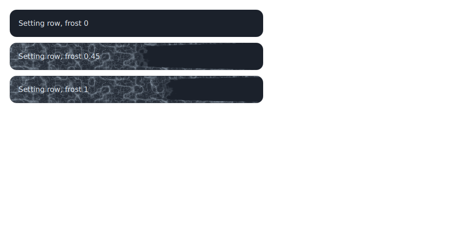

# Frost hover (set aside)

Hover effect kept from the retired Christmas layer (28 November 2026): on a
hovered settings row, frost crystals grow in from the left edge over 900 ms
(OutCubic) and melt back over 440 ms (InCubic) when the pointer leaves. The user
liked it; reuse it when a feature needs a winter or "cold" hover.

Not installed from here: `install.py` only deploys `payload/` and `scripts/`. The Christmas layer ships a copy as
`payload/christmas/ChristmasFrost.qml` (hooked into `SettingsRow` by `christmas.py`).



## Files

| File | Role |
| --- | --- |
| `FrostEdge.qml` | Self-contained component. No singleton, no clock: the shader is loaded only while `growth > 0` and redraws only while `growth` animates. |
| `shaders/frost.frag` | Frost only, sizes in pixels, rounded-rect mask, premultiplied output. |
| `shaders/frost.frag.qsb` | Built with `/usr/lib/qt6/bin/qsb --qt6 -o shaders/frost.frag.qsb shaders/frost.frag`. |
| `preview.qml` | Usage example and visual check. Run it on the real display, `QT_QPA_PLATFORM=wayland /usr/lib/qt6/bin/qml preview.qml`: the offscreen platform renders in software and silently skips shaders. |

Properties: `engaged`, `active` (the owning feature's switch), `direction`
(1 left, -1 right, 2 bottom, 0 every edge), `intensity` (0.45), `cornerRadius`,
`tint` (`#dcefff`), `growDuration`, `meltDuration`.

## Hooking it into SettingsRow

This is how the Christmas layer installed it. The block went after `    id: root\n` in
`reusables/guide/SettingsRow.qml`, next to the Halloween `EdgeMist` block that
uses the same pattern. Replace `MyFeature.enabled` with the real switch:

```qml
    property HoverHandler frostHover: HoverHandler {
        parent: root
        enabled: MyFeature.enabled && root.isOwnTabLive()
    }
    // Explicit parent/property: SettingsRow's default children are controls.
    property Item frostEdge: FrostEdge {
        parent: root
        anchors.fill: parent
        visible: root.isOwnTabLive()
        active: MyFeature.enabled
        engaged: root.enabled && !root.dimmed && (root.frostHover.hovered || root.highlightFlash > 0.1)
        cornerRadius: root.cornerRadius
    }
```

When shipping it:

- Copy the folder under `payload/<feature>/`, declare `FrostEdge 1.0 <feature>/FrostEdge.qml`
  in the shell `qmldir`, and wrap the hook in marked `// BEGIN`/`// END` blocks with
  a `strip()` so install stays idempotent and removable (see `seasonal.py`).
- Deploy the `.qsb` under a content-hashed name and rewrite the path in
  `FrostEdge.qml`: Qt caches shader programs by URL across hot reloads (see
  `shader_package_name` and `shader_dirs` in `install.py`).
- The Capri and Clawd test fixtures copy the installed `SettingsRow.qml`, so they
  must also copy the folder and declare the type, or they fail with
  "FrostEdge is not a type".
- Don't name a property like a built-in Item property (`baseline`, `top`,
  `palette`, `smooth`, `state`).
